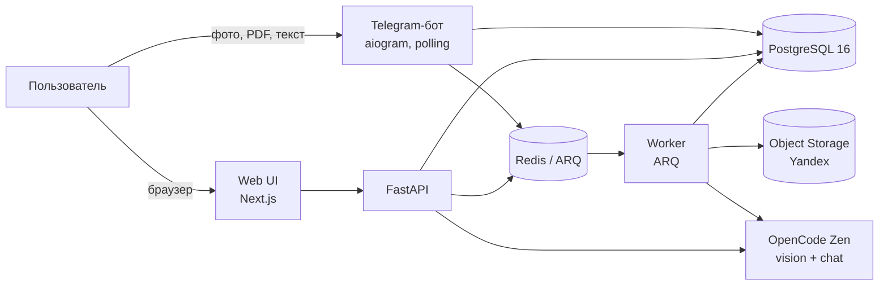
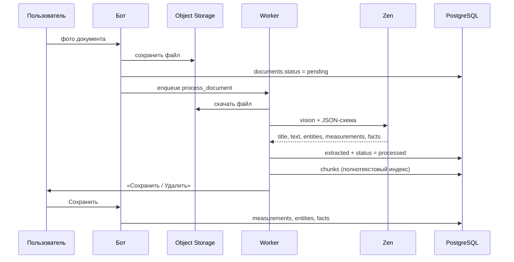
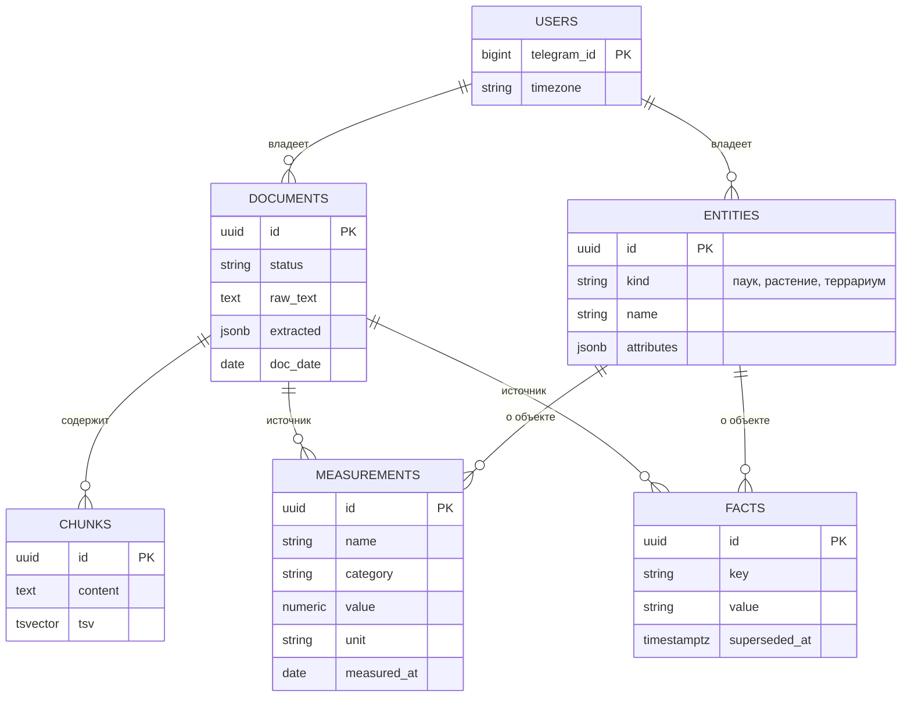
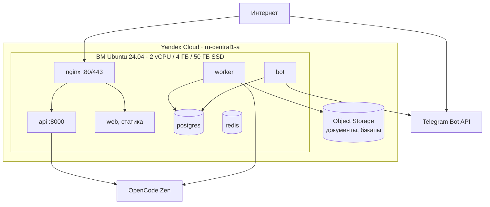

# Архитектура

Персональный ассистент: Telegram-бот + HTTP API, память документов и наблюдений,
все данные — в Yandex Cloud (РФ), LLM — OpenCode Zen.

## Компоненты

## Поток обработки документа

## Модель данных

## Деплой

## Границы доверия

- Наружу открыты только `443` (nginx) и `22` (SSH с ключом).
- API закрыт `WEB_TOKEN`, публичной регистрации нет.
- Бот отвечает только Telegram ID из `TELEGRAM_ALLOWED_IDS`.
- Фото и PDF лежат в приватном бакете; доступ — по ключу сервисного аккаунта.
- В Zen уходят только текст запроса и изображение документа; ключи и БД наружу не уходят.

## Telegram из России

`api.telegram.org` с российских сетей недоступен (проверено: IPv4 — таймаут, IPv6 — отказ).
Порядок действий:

1. На ВМ в Yandex Cloud проверить `curl -I https://api.telegram.org` — у облака свой аплинк, может работать.
2. Если не работает: зарубежный VPS (~300–400 ₽/мес, 1 vCPU / 1 ГБ) с HTTP-прокси,
   разрешённым только на `api.telegram.org`; в `.env` задать `TELEGRAM_PROXY_URL`.
3. Прокси видит только домен и порт — содержимое защищено TLS.

## Этапы

| Фаза | Что | Статус |
|---|---|---|
| 0 | ВМ, S3, docker compose, бэкапы | ждёт разблокировки биллинга |
| 1 | документы → OCR → подтверждение → RAG | код готов |
| 2 | графики метрик, карточки объектов | не начато |
| 3 | календарь, почта, напоминания по уходу | не начато |
| 4 | Web UI, голос, агентские сценарии | не начато |
